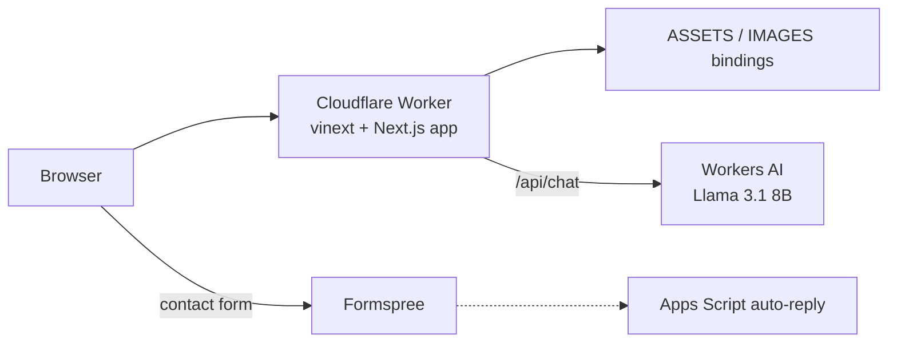

<div align="center">


**Live: [portfolio.briandol.workers.dev](https://portfolio.briandol.workers.dev/)**

</div>

The source of my personal portfolio: project case studies, experience timeline, an AI assistant that answers questions about my background, and a contact form with an automatic reply.

## ✨ Features

- 🗂️ **Project gallery** and **case study pages** generated from data (`app/work/[slug]`, `lib/projectCaseStudies.ts`)
- 🧭 **Interactive architecture diagrams** per case study (`components/ArchitectureDiagram.tsx`, `lib/architectureDiagrams.ts`)
- 🤖 **AI chatbot** backed by Cloudflare Workers AI (`POST /api/chat`, `@cf/meta/llama-3.1-8b-instruct-fp8`) with a profile-grounded system prompt, same-origin check, and input limits (12 messages, 600 characters each)
- 💚 **Health endpoint** (`GET /api/health`) shown live in the UI by `ApiStatus`
- ✉️ **Contact form** posting to Formspree, plus a Google Apps Script (`scripts/auto-reply.gs`) that sends an acknowledgement email with honeypot and per-address hourly cooldown
- 🕰️ Timeline and technology popups

## 🏗️ Architecture



[vinext](https://github.com/cloudflare/vinext) runs the Next.js app on Workers; `cloudflare.config.ts` declares the worker with `ASSETS`, `IMAGES` and `AI` bindings.

## 🧰 Tech stack

| Layer | Technology |
| --- | --- |
| Framework | Next.js ^16, React ^19, TypeScript ^5.9 |
| Build / runtime | Vite ^8, `vinext` ^1.2, `@vinext/cloudflare`, `@cloudflare/vite-plugin` |
| AI | Cloudflare Workers AI |
| Forms | Formspree, Google Apps Script |
| Icons | `simple-icons` |

## 🚀 Getting started

```bash
git clone https://github.com/Brian-Dol/brian-website-portfolio.git
cd brian-website-portfolio
npm install

npm run dev           # standard Next.js dev server
npm run dev:vinext    # Cloudflare-compatible dev server on :3001
npm run typecheck
npm run build:vinext  # production Workers build
npm run start:vinext  # preview the build
```

`/api/chat` needs the Workers AI binding, so test the chatbot through the vinext/Cloudflare build rather than plain `next dev`.

### Deploy

```bash
npm run deploy:vinext
```

For Git-based deploys, connect the repo in Cloudflare Workers Builds with build command `npm run build:vinext`, deploy command `npm run deploy:vinext`, production branch `main`.

## 📁 Project structure

```
app/            # pages, work/[slug] case studies, api/chat, api/health
components/     # Chatbot, ContactForm, ArchitectureDiagram, Timeline, ...
lib/            # profile (chatbot prompt), case studies, diagram data
scripts/        # auto-reply.gs (Google Apps Script)
cloudflare.config.ts  vite.config.ts
```

## 🗺️ Notes

- The vinext adapter and several dependencies are beta/pre-release; re-run the build after upgrades.
- The Apps Script must be deployed separately from script.google.com as a web app.

## 👤 Author

**Brian Dol**, Senior Full Stack Engineer · [Portfolio](https://portfolio.briandol.workers.dev/) · [LinkedIn](https://linkedin.com/in/brian-dol-31a06115a/)
